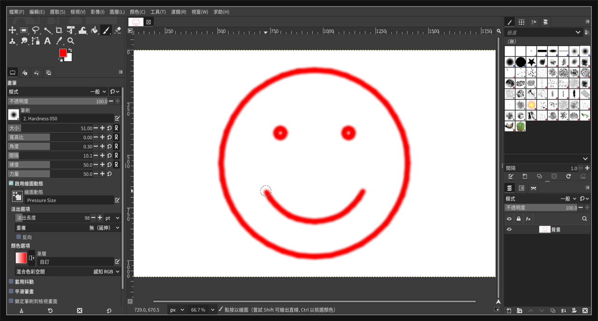

# hypr-computer-use-mcp 技術文件

這份文件說明 agent（Claude Code、Codex）如何在 Hyprland 上「用電腦」，而且**不跟你搶滑鼠和鍵盤**。

> 上圖：agent 在 realm 裡開 GIMP、新增畫布，用 70 次 `drag` 畫出笑臉。整個過程中，使用者的 focus、
> workspace、游標都沒有被動到。

## 閱讀順序

| 文件 | 內容 |
|---|---|
| [architecture.md](architecture.md) | 整體架構、模組分工、一次 tool call 的流程 |
| [realm.md](realm.md) | 為什麼要 nested Hyprland、隱藏時如何持續 render、生命週期 |
| [input.md](input.md) | 截圖座標系統、點擊／捲動／打字／拖曳的實作 |
| [nixos-integration.md](nixos-integration.md) | flake 打包、註冊、ws1 icon、故障排除 |
| [lessons-learned.md](lessons-learned.md) | 開發過程踩過的坑，以及每個坑的根因和解法 |

## 一句話總結

把 agent 關進一個 **nested Hyprland（realm）**，放在 ws1 的視窗裡，用 `render_unfocused` 讓它在隱藏時
也以 15 FPS 持續更新；所有截圖和輸入都送進 realm 的 Wayland socket，所以永遠碰不到使用者的 session。
realm 隱藏時，CPU 總用量大約 4%。
