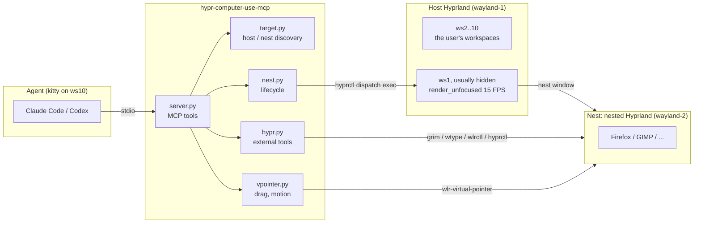
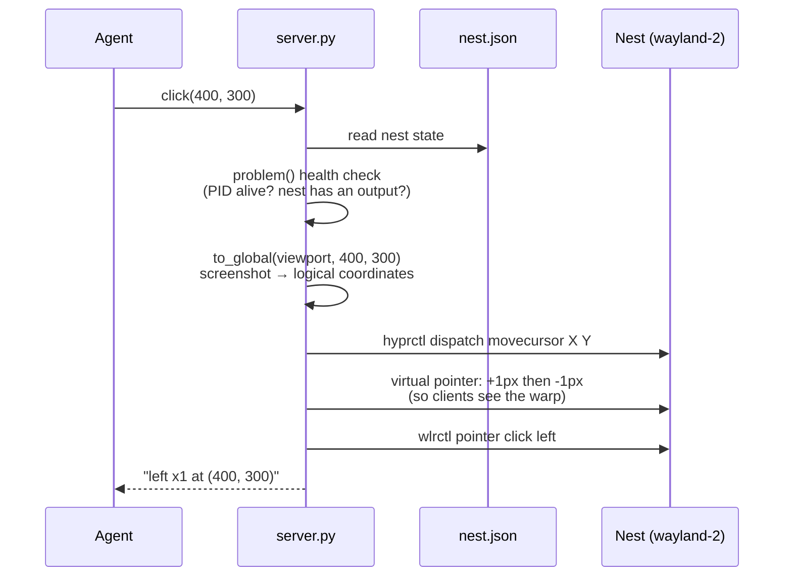

# Architecture

## Overview



The agent talks to the MCP server over stdio. The server turns each tool call into external commands
(`grim`, `wtype`, `wlrctl`, `hyprctl`) or Wayland protocol requests aimed at the **nest**. Every command
carries the nest's `WAYLAND_DISPLAY` and `HYPRLAND_INSTANCE_SIGNATURE`, so it can only act on the nest.

## Modules

| Module | Responsibility | Side effects |
|---|---|---|
| `geometry.py` | Screenshot coordinates ↔ Hyprland global logical coordinates (position, scale, rotation) | Pure |
| `keys.py` | `"ctrl+shift+t"` → `wtype` arguments | Pure |
| `target.py` | Decide which session to act on (host or nest) and build its environment | Reads lock files only |
| `hypr.py` | Wrap `hyprctl`, `grim`, `wtype`, `wlrctl`; every call takes a `Target` | Yes |
| `nest.py` | Start, health-check, repair and stop the nest | Yes |
| `vpointer.py` | Press-and-hold drags and real pointer motion via wlr-virtual-pointer | Yes |
| `server.py` | MCP tools and the CLI (`nest up\|down\|status`) | Yes |
| `protocols/` | pywayland bindings, **generated at build time** (see [lessons-learned](lessons-learned.md#6-vendored-bindings-failed-to-import-once-deployed)) | — |

Pure logic lives inside, side effects at the edges: coordinate mapping and key parsing are unit-tested,
and external commands are concentrated in `hypr.py`.

## `Target`: how every action is addressed

```python
@dataclass(frozen=True)
class Target:
  kind: Literal["host", "nest"]
  signature: str          # HYPRLAND_INSTANCE_SIGNATURE
  wayland_display: str    # e.g. wayland-2
  runtime_dir: str        # $XDG_RUNTIME_DIR
```

`hypr.run(*args, target=...)` overlays these values onto the child process environment, so the same
`grim` binary can capture either the host or the nest depending on the `Target` passed in.

### Finding the host and the nest

- **nest**: after `nest up` succeeds, its signature, display and PID are written to
  `$XDG_RUNTIME_DIR/hypr-cu/nest.json`.
- **host**: taken from the environment when present; otherwise the newest live instance found by scanning
  `$XDG_RUNTIME_DIR/hypr/*/hyprland.lock` (each holds the PID and Wayland socket name), **excluding the
  nest**.

Excluding the nest matters: it is itself a Hyprland instance, and newer than the host. MCP hosts such as
Codex strip the environment, so "pick the newest" alone would mistake the nest for the host.

## The life of a tool call

Taking `click(x=400, y=300)` as an example:



When the nest is unhealthy (not started, compositor exited, window closed), tools return an explicit error
such as `nest window was closed; call start_nest first`. They **never** silently fall back to driving the
user's desktop.

## Tools

| Category | Tools |
|---|---|
| Nest management | `start_nest`, `stop_nest` |
| Launching | `open_url`, `launch` |
| Observing | `screenshot`, `list_monitors`, `list_windows`, `cursor_position` |
| Acting | `click`, `scroll`, `mouse_move`, `drag`, `type_text`, `key`, `focus_window` |

Read-only tools carry `readOnlyHint` so MCP hosts can base permission policy on it.

## State files

| Path (under `$XDG_RUNTIME_DIR/hypr-cu/`) | Contents | Used for |
|---|---|---|
| `nest.json` | The nest's signature, display and PID | Locating the nest; status bars showing whether it runs |
| `activity` | Empty file whose mtime is the last tool call | Status bars showing whether the agent is acting |
| `nest.conf` | The nested Hyprland config | Generated by `nest up` |
| `nest.log` | Output of the nested Hyprland | Debugging |
