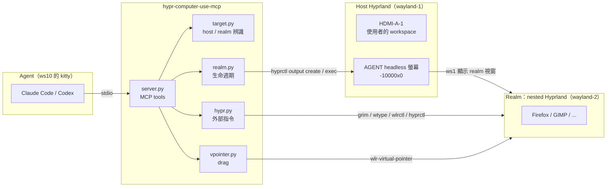
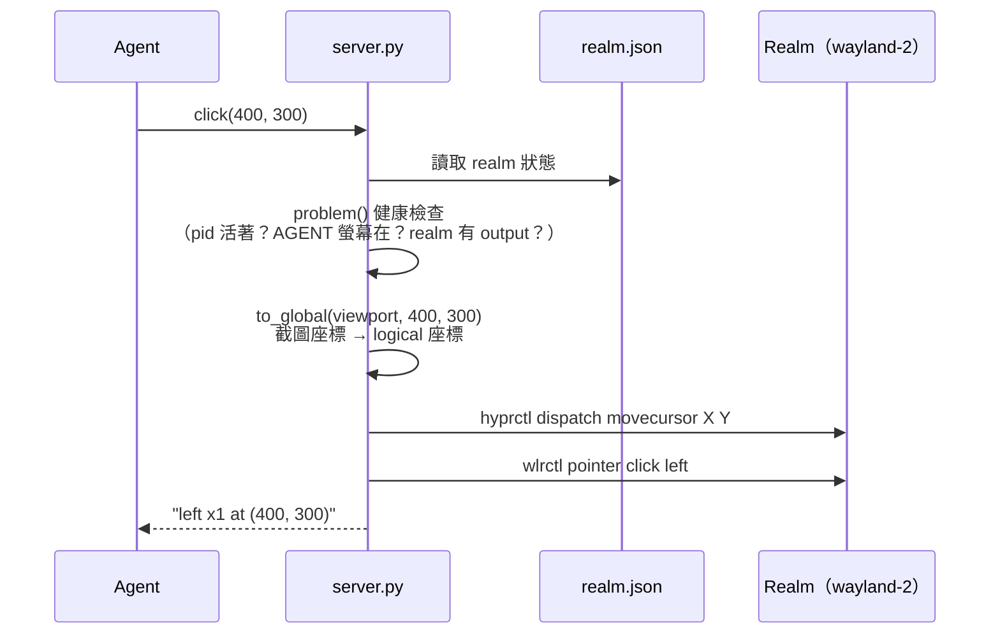

# 架構

## 全貌



Agent 透過 stdio 跟 MCP server 溝通。server 把每個 tool call 轉成對 **realm** 的外部指令
（`grim`、`wtype`、`wlrctl`、`hyprctl`）或 Wayland 協定呼叫。所有指令都帶著 realm 的
`WAYLAND_DISPLAY` 和 `HYPRLAND_INSTANCE_SIGNATURE`，因此只會作用在 realm。

## 模組分工

| 模組 | 職責 | 是否有副作用 |
|---|---|---|
| `geometry.py` | 截圖座標 ↔ Hyprland 全域 logical 座標（處理位置、scale、旋轉） | 純函式 |
| `keys.py` | `"ctrl+shift+t"` → `wtype` 參數 | 純函式 |
| `target.py` | 決定要操作哪個 session（host 或 realm），並產生對應的 env | 只讀 lock 檔 |
| `hypr.py` | 包裝 `hyprctl`、`grim`、`wtype`、`wlrctl`；每個呼叫都要指定 `Target` | 有 |
| `realm.py` | realm 的啟動、健康檢查、修復、關閉 | 有 |
| `vpointer.py` | 透過 wlr-virtual-pointer 做按住拖曳 | 有 |
| `server.py` | MCP tools 和 CLI（`realm up\|down\|status`） | 有 |
| `protocols/` | pywayland bindings，**build 時生成**（見 [lessons-learned](lessons-learned.md#6-vendored-bindings-在部署時-import-失敗)） | — |

設計原則是「純函式在內、副作用在外」：座標換算和按鍵解析都有單元測試，外部指令集中在 `hypr.py`。

## `Target`：一切操作的定址方式

```python
@dataclass(frozen=True)
class Target:
  kind: Literal["host", "realm"]
  signature: str          # HYPRLAND_INSTANCE_SIGNATURE
  wayland_display: str    # 例如 wayland-2
  runtime_dir: str        # $XDG_RUNTIME_DIR
```

`hypr.run(*args, target=...)` 會把這三個值覆蓋到子行程的環境變數，所以同一支 `grim` 可以截
host，也可以截 realm，取決於傳入哪個 `Target`。

### 怎麼找到 host 和 realm

- **realm**：`realm up` 成功後把 signature、display、pid 寫進 `$XDG_RUNTIME_DIR/hypr-cu/realm.json`。
- **host**：優先使用環境變數；沒有的話，掃描 `$XDG_RUNTIME_DIR/hypr/*/hyprland.lock`
  （內容是 PID 和 Wayland socket 名稱），挑最新的、還活著的 instance，**但要排除 realm**。

排除 realm 這點很重要：realm 本身也是一個 Hyprland instance，而且比 host 新。Codex 這類 MCP host
會剝掉環境變數，如果只挑「最新的」，就會把 realm 誤認成 host。

## 一次 tool call 的流程

以 `click(x=400, y=300)` 為例：



realm 不健康時（沒啟動、視窗被關掉、AGENT 螢幕不見了），tool 會回傳明確的錯誤，例如
`realm window was closed; call start_realm first`，**不會**悄悄改去操作使用者的桌面。

## Tools 一覽

| 類別 | Tools |
|---|---|
| realm 管理 | `start_realm`、`stop_realm` |
| 開程式 | `open_url`、`launch` |
| 觀察 | `screenshot`、`list_monitors`、`list_windows`、`cursor_position` |
| 操作 | `click`、`scroll`、`mouse_move`、`drag`、`type_text`、`key`、`focus_window` |

只讀的 tools 有標 `readOnlyHint`，讓 MCP host 可以依此決定權限策略。
