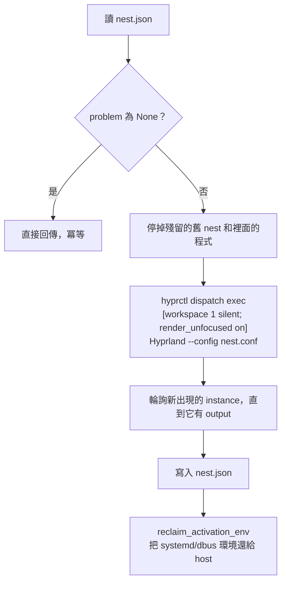

# Nest：給 agent 的獨立桌面

## 問題：computer use 會搶走你的電腦

最直覺的做法是直接操作使用者的桌面：用 `grim` 截圖，用 virtual pointer/keyboard 送輸入。但：

- 輸入事件會送到**目前 focus 的視窗**，agent 動作時你沒辦法同時用電腦。
- 只有畫面上看得到的 workspace 才截得到，agent 要做事就得把你的畫面切走。
- Wayland **沒有任何協定**能把滑鼠點擊送給一個沒有 focus 的視窗。Hyprland 的 `sendshortcut`
  只能送鍵盤。
- Hyprland 只有一個 seat（一組游標和 focus）。

## 解法：nested Hyprland

Hyprland 可以在另一個 Wayland session 裡面跑成一個普通視窗。這個 nested instance 有自己的：

- Wayland display（例如 `wayland-2`）
- seat：游標、鍵盤 focus
- 視窗管理和 `hyprctl` IPC

agent 的所有動作都送進 nested instance，host 完全感覺不到。我們把它叫做 **nest**。

```
你的 Hyprland (wayland-1)
├── ws2..10：你的 workspace、游標、focus（不受影響）
└── ws1（通常是隱藏的）── nest 視窗 ── nested Hyprland (wayland-2)
                                           ├── 自己的 seat、游標、focus
                                           └── agent 的 Firefox / GIMP
```

想看 agent 在做什麼，就切到 ws1（`super+1`），跟切到任何 workspace 一樣。

## 關鍵：隱藏時也要持續 render

nested Hyprland 是 host 的一個 client，靠 host 送來的 `wl_surface.frame` callback 決定何時畫下一張。
host **不會**送 callback 給隱藏 workspace 上的視窗，所以 nest 一被隱藏就停住，`grim` 截圖也會卡死。

解法是 Hyprland 的 window rule **`render_unfocused`**：被標記的視窗在隱藏時，host 仍會以
`misc:render_unfocused_fps`（預設 15）的頻率送 frame callback。nest 啟動時用 exec rule 套用：

```
hyprctl dispatch exec "[workspace 1 silent; render_unfocused on] Hyprland --config nest.conf"
```

這條 rule **只在視窗建立時生效**，事後用 `setprop` 修改沒有作用，所以一定要放在 exec rule 裡。

| 情境 | 結果 | CPU（host + nested） |
|---|---|---|
| 一般的隱藏 workspace | ❌ `grim` 卡住 | — |
| 舊設計：headless 螢幕 `AGENT` | ✅ 可以截圖 | **約 110–130%** |
| **隱藏 workspace + `render_unfocused`** | ✅ 15 FPS 持續更新 | **約 4%** |

### 為什麼不用 headless 螢幕（舊設計）

最早的版本開了一台 headless 螢幕 `AGENT`，把 nest 放在上面，讓 host 以為它一直在顯示。這樣能動，
但有嚴重的效能問題：**headless 螢幕沒有 vblank**。host 畫完 AGENT 就立刻送 frame callback，nest 收到
就立刻畫下一張，host 又立刻重新合成，兩邊互相觸發，形成沒有節流的迴圈。實測 debug overlay：

| 螢幕 | FPS |
|---|---|
| HDMI-A-1（實體） | 59 |
| AGENT（headless） | **674** |
| nest 內部 | **492** |

這個架構還帶來一連串副作用：滑鼠可能掉進看不見的螢幕、config reload 會把 AGENT 移到實體螢幕旁邊、
`super+1` 需要特製的切換腳本。改成 `render_unfocused` 之後，這些問題全部消失。詳見
[lessons-learned](lessons-learned.md#15-headless-螢幕讓兩層-compositor-空轉)。

## 生命週期

### `nest up`



- **冪等**：nest 健康時直接回傳。agent 重複呼叫 `start_nest` 不會開出第二個。
- **自動修復**：`problem()` 檢查三件事：有沒有啟動、compositor 是否還活著、nest 是否還有 output。
  最後一項是因為 nest 視窗被關掉時，nested process 還會活著，但已經沒有任何 output。
- **不搶畫面**：`workspace 1 silent` 讓視窗在背景建立，你的畫面和 focus 都不會被切走。
- **精簡 config**：nested 不跑 autostart、bar、桌布，也關掉動畫和 watchdog 警告。

### `nest down`

1. **先關 nest 裡的程式**：nest 裡啟動的程式都繼承了 nest 的 `HYPRLAND_INSTANCE_SIGNATURE`，
   用它掃 `/proc/*/environ` 就能找到全部。先送 `SIGTERM` 讓 Firefox 這類程式正常存檔關閉，5 秒內
   沒結束才 `SIGKILL`。這些程式不一定是 compositor 的子行程，而且 **Wayland client 不一定會隨著
   compositor 結束**：曾經有 nest 的 Firefox 在 nest 關掉後繼續活著，還佔住 profile lock。
2. 對 nested 送 `dispatch exit`，3 秒內沒結束就送 `SIGTERM`。
3. 清掉 nested fork 出來的 helper process（用 config 路徑比對 `/proc/*/cmdline`）。
4. 還原 activation environment（原因見下一節）。

### Activation environment 被 nest 搶走

每個 Hyprland 啟動時都會把自己的 `WAYLAND_DISPLAY` 和 `HYPRLAND_INSTANCE_SIGNATURE` 寫進 systemd
和 dbus 的 user environment，nested 的也不例外；結束時還會刪掉 signature，但把自己的
`WAYLAND_DISPLAY` 留下來。

如果不處理，之後重啟的 user service（例如 AGS bar）會連進 nest，nest 關掉後就連到一個已經不存在的
socket，不斷 crash。Hyprland 0.54 不支援 `HYPRLAND_NO_SD_VARS`，所以 `nest.py` 在兩個時間點主動還原：

- `up` 之後：輪詢最多 5 秒，等 nested 匯出變數後再改回 host 的值。
- `down` 之後：nested 結束時會再改一次，所以要等它停止後才還原。

## 資源成本

| 情境 | host | nested | nest 的 Firefox |
|---|---|---|---|
| nest 隱藏、畫面靜止 | ~4% | ~0.4% | ~0% |
| nest 隱藏、播音樂（YouTube Music 歌曲模式） | ~4% | ~0.4% | ~6% |

nest 隱藏時以 15 FPS 更新，所以 agent 動作後要稍等一下再截圖。切到 ws1 觀看時，會跟一般視窗一樣以
螢幕的更新率顯示。

## 隔離的範圍

nest 隔離的是**顯示和輸入**，不是作業系統層級的 sandbox：

- nest 裡的程式以你的使用者身分執行，可以讀寫你的家目錄、使用網路。
- nest 裡的 GIMP 用的是你的 `~/.config/GIMP`，最近開啟的檔案清單、筆刷設定都是共用的。
- Firefox 例外：`open_url` 使用獨立又持久的 profile（`$XDG_DATA_HOME/hypr-cu/firefox-profile`），跟你的
  主力 Firefox 完全分開。server 會在每次啟動前寫入 `user.js`，關掉 session 還原、翻譯提示等會打斷
  agent 的對話框。

建議只在 nest 裡登入你願意讓 agent 使用的帳號。
