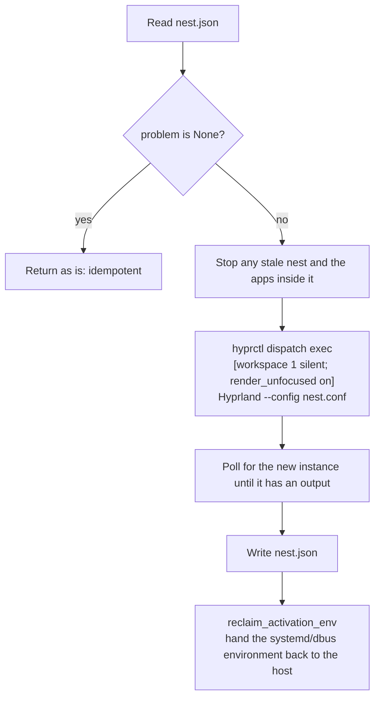

# The nest: a desktop of the agent's own

## The problem: computer use takes over your computer

The obvious approach is to drive the user's desktop directly: capture with `grim`, inject input with a
virtual pointer and keyboard. But:

- Input goes to **whatever window has focus**, so you can't use the computer while the agent works.
- Only visible workspaces can be captured, so the agent has to switch your screen away to see anything.
- Wayland has **no protocol** for sending a click to an unfocused window. Hyprland's `sendshortcut` only
  covers the keyboard.
- Hyprland has a single seat: one cursor, one focus.

## The solution: a nested Hyprland

Hyprland can run as an ordinary window inside another Wayland session. That nested instance has its own:

- Wayland display (e.g. `wayland-2`)
- seat: cursor and keyboard focus
- window management and `hyprctl` IPC

Everything the agent does is sent to the nested instance; the host never notices. We call it the
**nest**.

```
your Hyprland (wayland-1)
├── ws2..10: your workspaces, cursor and focus (untouched)
└── ws1 (usually hidden) ── nest window ── nested Hyprland (wayland-2)
                                            ├── its own seat, cursor and focus
                                            └── the agent's Firefox / GIMP
```

To watch the agent, switch to ws1 (`super+1`) like any other workspace.

## The key: keep rendering while hidden

The nested Hyprland is a client of the host and draws its next frame when the host sends a
`wl_surface.frame` callback. The host **doesn't** send callbacks to windows on hidden workspaces, so a
hidden nest stalls, and `grim` hangs waiting for a frame that never comes.

The fix is Hyprland's **`render_unfocused`** window rule: while a tagged window is hidden, the host keeps
sending frame callbacks at `misc:render_unfocused_fps` (15 by default). The nest is launched with it as an
exec rule:

```
hyprctl dispatch exec "[workspace 1 silent; render_unfocused on] Hyprland --config nest.conf"
```

The rule **only takes effect when the window is mapped**; setting it later with `setprop` does nothing,
so it has to be an exec rule.

| Setup | Result | CPU (host + nested) |
|---|---|---|
| Plain hidden workspace | ❌ `grim` hangs | — |
| Earlier design: headless monitor `AGENT` | ✅ captures work | **~110–130%** |
| **Hidden workspace + `render_unfocused`** | ✅ steady 15 FPS | **~4%** |

### Why not a headless monitor (earlier design)

The first version created a headless monitor, `AGENT`, and parked the nest on it so the host would
consider it always visible. It worked, but performed terribly: **a headless output has no vblank**. The
host sent a frame callback the instant it finished drawing AGENT, the nest drew its next frame the
instant it got one, and the host recomposited immediately: an unthrottled ping-pong. The debug overlay
showed:

| Monitor | FPS |
|---|---|
| HDMI-A-1 (physical) | 59 |
| AGENT (headless) | **674** |
| Inside the nest | **492** |

The design also had knock-on problems: the cursor could slip onto an invisible monitor, a config reload
moved AGENT next to the real monitor, and `super+1` needed a custom workspace-switch script. All of them
went away with `render_unfocused`. See
[lessons-learned](lessons-learned.md#15-a-headless-monitor-made-two-compositors-spin).

## Lifecycle

### `nest up`



- **Idempotent**: a healthy nest is returned as is, so repeated `start_nest` calls never start a second
  one.
- **Self-repairing**: `problem()` checks three things: whether it was started, whether the compositor is
  alive, and whether the nest still has an output. The last one catches a closed nest window, after which
  the nested process lives on with no outputs.
- **Never steals the screen**: `workspace 1 silent` maps the window in the background; your view and
  focus stay put.
- **Minimal config**: the nest runs no autostart, bar or wallpaper of its own (see
  [nixos-integration](nixos-integration.md) for adding some), with animations and the watchdog warning
  disabled.

### `nest down`

1. **Close the apps inside first.** Everything launched in the nest inherits its
   `HYPRLAND_INSTANCE_SIGNATURE`, so scanning `/proc/*/environ` finds all of them. They get `SIGTERM` so
   Firefox and friends can shut down cleanly, then `SIGKILL` after 5 seconds. They aren't reliably
   children of the compositor, and **Wayland clients don't necessarily exit with their compositor**: a nest
   Firefox once kept running after the nest stopped, still holding its profile lock.
2. Send `dispatch exit` to the nest, then `SIGTERM` if it is still alive after 3 seconds.
3. Kill helper processes the nested Hyprland forked (matched by config path in `/proc/*/cmdline`).
4. Restore the activation environment (see below).

### The nest hijacks the activation environment

Every Hyprland, nested ones included, exports its `WAYLAND_DISPLAY` and `HYPRLAND_INSTANCE_SIGNATURE` to
the systemd and dbus user environment on startup. On exit it removes the signature but leaves its
`WAYLAND_DISPLAY` behind.

Left alone, user services restarted later (such as the AGS bar) attach to the nest, then crash-loop on a
dead socket once it stops. Hyprland 0.54 doesn't honour `HYPRLAND_NO_SD_VARS`, so `nest.py` restores the
host's values at two points:

- after `up`: poll for up to 5 seconds until the nest has exported, then restore;
- after `down`: the exiting compositor rewrites the environment once more, so restore only after it stops.

## Resource cost

| Scenario | Host | Nested | Nest Firefox |
|---|---|---|---|
| Nest hidden, static content | ~4% | ~0.4% | ~0% |
| Nest hidden, playing music (YouTube Music in song mode) | ~4% | ~0.4% | ~6% |

A hidden nest updates at 15 FPS, so the agent should give it a moment after acting before taking a
screenshot. While you watch it on ws1, it renders at the monitor's refresh rate like any window.

## What is and isn't isolated

The nest isolates **display and input**. It is not an OS-level sandbox:

- Apps in the nest run as your user, with your home directory and network.
- GIMP in the nest uses your `~/.config/GIMP`, recent files and brush settings included.
- Firefox is the exception: `open_url` uses a separate, persistent profile
  (`$XDG_DATA_HOME/hypr-cu/firefox-profile`), fully apart from your main Firefox. Firefox remoting is
  scoped to the profile, so while the nest Firefox runs, new URLs open as tabs in it and never reach your
  main Firefox. Before each launch the server writes a `user.js` that disables session restore,
  translation prompts and other dialogs that would interrupt the agent.

Only sign in to accounts in the nest that you are willing to let the agent use.
