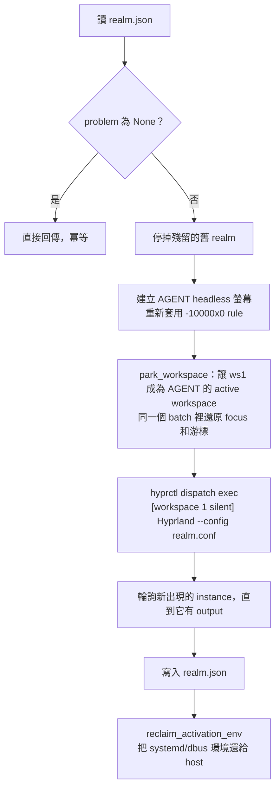

# Realm：給 agent 的獨立桌面

## 問題：computer use 會搶走你的電腦

最直覺的做法是直接操作使用者的桌面：用 `grim` 截圖，用 virtual pointer/keyboard 送輸入。但：

- 輸入事件會送到**目前 focus 的視窗**，agent 動作時你沒辦法同時用電腦。
- 只有畫面上看得到的 workspace 才截得到，agent 要做事就得把你的畫面切走。
- Wayland **沒有任何協定**能把滑鼠點擊送給一個沒有 focus 的視窗。Hyprland 的 `sendshortcut`
  只能送鍵盤。
- Hyprland 只有一個 seat（一組游標和 focus），就算多開一台虛擬螢幕，agent 要點那台螢幕時還是得把
  **你的**游標移過去。

## 解法：nested Hyprland

Hyprland 可以在另一個 Wayland session 裡面跑成一個普通視窗。這個 nested instance 有自己的：

- Wayland display（例如 `wayland-2`）
- seat：游標、鍵盤 focus
- 視窗管理和 `hyprctl` IPC

agent 的所有動作都送進 nested instance，host 完全感覺不到。我們把它叫做 **realm**。

```
你的 Hyprland (wayland-1)
├── HDMI-A-1 ── ws2..10：你的 workspace、游標、focus（不受影響）
└── AGENT（headless，位於 -10000x0）
      └── ws1 ── realm 視窗 ── nested Hyprland (wayland-2)
                                 ├── 自己的 seat、游標、focus
                                 └── agent 的 Firefox / GIMP
```

## 為什麼一定要 headless 螢幕

實驗中發現，**把 realm 放在一般的隱藏 workspace 會完全停擺**：

1. host 不會 render 隱藏 workspace 上的視窗，也不會送 `wl_surface.frame` callback 給它。
2. nested Hyprland 是 host 的 client，收不到 frame callback 就不會畫新的 frame。
3. `grim` 對 nested 截圖時，screencopy 會一直等待永遠不會來的 frame，**直接卡死**。

解法是開一台 headless 虛擬螢幕 `AGENT`，把 ws1 放上去當它的 active workspace。對 host 來說，
ws1 一直「在顯示中」，所以會持續 render，nested 也就持續有 frame。

| 情境 | 截圖結果 |
|---|---|
| realm 在一般的隱藏 workspace | ❌ `grim` 卡住 |
| realm 在 AGENT 上，但 AGENT 顯示的是別的 workspace | ❌ `grim` 卡住 |
| realm 在 AGENT 上，而且 ws1 是 AGENT 的 active workspace | ✅ 每次截圖內容都會更新 |

### AGENT 放在 `-10000x0`

如果 AGENT 跟實體螢幕相鄰，你的滑鼠往旁邊一推就會掉進一台看不見的螢幕。放在 `-10000x0`，跟任何實體
螢幕都不相鄰，游標就移不過去。

這個位置必須**同時**寫進 Hyprland config：用 `hyprctl keyword` 設定的 monitor rule 在 config reload
時會消失，Hyprland 會把 AGENT 重新放到實體螢幕旁邊（實際發生過，見
[lessons-learned](lessons-learned.md#4-config-reload-把-agent-移到你的螢幕旁邊)）。

## 生命週期

### `realm up`



幾個細節：

- **冪等**：realm 健康時直接回傳。agent 重複呼叫 `start_realm` 不會開出第二個。
- **自動修復**：`problem()` 會檢查四件事：有沒有啟動、compositor process 是否還活著、AGENT 螢幕是否
  存在、realm 是否還有 output。只要任何一項有問題，`up` 就會重建。最後一項是因為 realm 視窗被關掉時，
  nested process 還會活著，但已經沒有任何 output。
- **不搶 focus**：要讓 AGENT 顯示 ws1，就必須先 focus AGENT，而 `focusmonitor` 會 warp 游標。所以
  focus 切換、切回原本的視窗、還原游標，全部放在同一個 `hyprctl --batch` 裡，中間不會處理任何輸入。
- **精簡 config**：nested 不跑 autostart、bar、桌布，也關掉動畫和 watchdog 警告。

### `realm down`

1. 對 nested 送 `dispatch exit`，3 秒內沒結束就送 `SIGTERM`。
2. **清掉 fork 出來的 helper**：nested Hyprland 會 fork helper process，主程式結束後它們會被 init 收養並
   殘留下來。用 nested config 的路徑比對 `/proc/*/cmdline`，找到後 `SIGKILL`。
3. **還原 activation environment**：必須在 compositor 停止**之後**做，原因見下一節。
4. 移除 AGENT 螢幕，並還原游標（移除 output 會把游標移到螢幕正中央）。

### Activation environment 被 realm 搶走

每個 Hyprland 啟動時都會把自己的 `WAYLAND_DISPLAY` 和 `HYPRLAND_INSTANCE_SIGNATURE` 寫進 systemd
和 dbus 的 user environment，nested 的也不例外；結束時還會刪掉 signature，但把自己的
`WAYLAND_DISPLAY` 留下來。

如果不處理，之後重啟的 user service（例如 AGS bar）會連進 realm，realm 關掉後就連到一個已經不存在的
socket，不斷 crash。Hyprland 0.54 不支援 `HYPRLAND_NO_SD_VARS`，所以 `realm.py` 在兩個時間點主動還原：

- `up` 之後：輪詢最多 5 秒，等 nested 匯出變數後再改回 host 的值。
- `down` 之後：nested 結束時會再改一次，所以要等它停止後才還原。

## 資源成本

realm 開著時大約吃掉一顆多的 CPU 核心（實測：nested 約 42%、host 合成約 67%）。沒有 realm 時，host
Hyprland 幾乎是 0%。

把 AGENT 從 60Hz 降到 10Hz **完全沒有效果**，瓶頸不在螢幕更新率。所以 agent 的使用說明會提醒它：
做完事要呼叫 `stop_realm`。

## 隔離的範圍

realm 隔離的是**顯示和輸入**，不是作業系統層級的 sandbox：

- realm 裡的程式以你的使用者身分執行，可以讀寫你的家目錄、使用網路。
- realm 裡的 GIMP 用的是你的 `~/.config/GIMP`，最近開啟的檔案清單、筆刷設定都是共用的。
- Firefox 例外：`open_url` 使用獨立又持久的 profile（`$XDG_DATA_HOME/hypr-cu/firefox-profile`），跟你的
  主力 Firefox 完全分開。

建議只在 realm 裡登入你願意讓 agent 使用的帳號。
